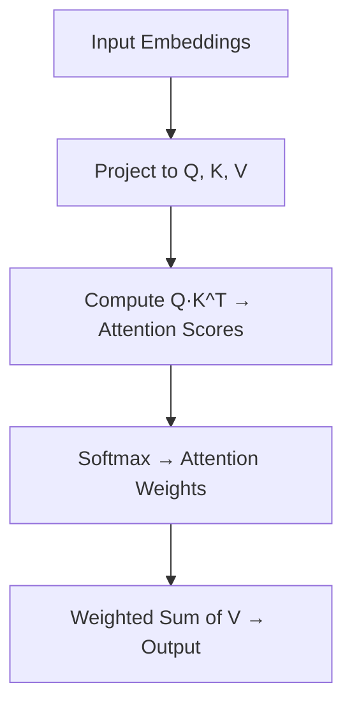

# Mastering Self-Attention: A Technical Deep Dive for Practitioners

## Why Self-Attention Powers Modern Sequence Modeling

Self-attention is a mechanism that lets every token in a sequence “look at” every other token at once, computing how much each pair should influence one another. Unlike recurrence (which processes tokens step-by-step) or convolution (which only sees a local window), self-attention captures long-range dependencies in constant time, making it uniquely powerful for tasks like translation or summarization. Think of a team brainstorming session where everyone listens to everyone else simultaneously—context flows freely, and the best ideas emerge from global interactions. This ability to weigh all positions equally is the backbone of transformer architectures, enabling models to handle sequences of arbitrary length without losing signal over distance.

> **[IMAGE GENERATION FAILED]** Abstract representation of self-attention where every token interacts with every other token simultaneously.
>
> **Alt:** Abstract diagram of self-attention mechanism showing tokens interacting globally
>
> **Prompt:** Create a clean, abstract diagram showing a sequence of tokens (e.g., words or symbols) connected by bidirectional arrows, representing global interaction. Use a minimalist style with a light background, soft colors, and clear labels. The diagram should emphasize the 'all-to-all' nature of self-attention without specific numerical values or complex details.
>
> **Error:** cannot import name 'genai' from 'google' (unknown location)


## Break down the self-attention mechanism into three key steps

Self-attention is the backbone of transformer models, enabling them to weigh the importance of different parts of an input sequence dynamically. At its core, it transforms input embeddings into three distinct representations—queries, keys, and values—before computing a context-aware output. Let’s break this down into three essential steps.

### Step 1: Projecting embeddings into query, key, and value spaces
Every input embedding (a vector representing a token in your sequence) is linearly projected into three separate spaces: **query (Q)**, **key (K)**, and **value (V)**. These projections are learned during training and allow the model to focus on different aspects of the input when computing attention. For example, the same word "bank" might be treated as a financial institution in one context and a river edge in another, depending on the query and key interactions.

### Step 2: Computing attention scores and weights
Once you have the queries and keys, the next step is to compute how much each token should "attend" to every other token in the sequence. This is done using a **dot product** between the query of one token and the key of another. The result is an **attention score**, which measures the similarity between the two tokens. Higher scores indicate stronger relationships.

These raw scores are then passed through a **softmax** function to normalize them into a probability distribution—**attention weights**. Softmax ensures that all weights sum to 1, making them interpretable as probabilities. This step is crucial because it allows the model to distribute focus across the sequence without favoring any single token disproportionately.

### Step 3: Weighted sum of values
With the attention weights in hand, the final step is to compute a **weighted sum of the values (V)**. Each value vector is multiplied by its corresponding attention weight, and the results are summed to produce the **context vector** for the token. This context vector now contains information from all relevant tokens in the sequence, weighted by their importance.

Here’s a simple Mermaid diagram to visualize the flow:



> **[IMAGE GENERATION FAILED]** Step-by-step flow of the self-attention mechanism: Input embeddings are projected into Q, K, and V spaces, attention scores are computed, normalized via softmax, and values are weighted and summed to produce the output.
>
> **Alt:** Flow diagram of self-attention mechanism with Q, K, V projections and softmax
>
> **Prompt:** Create a detailed but clean flowchart illustrating the self-attention mechanism. Start with 'Input Embeddings' on the left, followed by three branches labeled 'Query (Q)', 'Key (K)', and 'Value (V)' projections. Show the computation of attention scores (Q·K^T), followed by a softmax step, and finally the weighted sum of values (V). Use arrows to connect each step, and include labels for each stage. The style should be technical but easy to follow, with a neutral color scheme.
>
> **Error:** cannot import name 'genai' from 'google' (unknown location)


### Why softmax matters
The softmax function plays a pivotal role in self-attention. Without it, attention scores could grow arbitrarily large or small, leading to unstable gradients during training. By converting scores into a probability distribution, softmax ensures that the model’s focus remains balanced and interpretable. It also introduces non-linearity, which helps the model learn complex patterns in the data.

## Walk through a minimal self-attention implementation in pseudocode

Below is a compact pseudocode walkthrough that captures the essence of self-attention without framework-specific details. We’ll use the following notation:

- `X`: input matrix of shape `(seq_len, d_model)` — a sequence of `seq_len` vectors, each of size `d_model`.
- `W_q`, `W_k`, `W_v`: learned projection matrices of shape `(d_model, d_k)` for queries, keys, and values.
- `Q`, `K`, `V`: projected matrices of shape `(seq_len, d_k)`.
- `A`: attention score matrix of shape `(seq_len, seq_len)`.
- `O`: output matrix of shape `(seq_len, d_model)`.

```text
function self_attention(X, W_q, W_k, W_v):
    # Step 1: Project inputs to queries, keys, and values
    Q = X @ W_q  # (seq_len, d_model) @ (d_model, d_k) -> (seq_len, d_k)
    K = X @ W_k  # (seq_len, d_model) @ (d_model, d_k) -> (seq_len, d_k)
    V = X @ W_v  # (seq_len, d_model) @ (d_model, d_k) -> (seq_len, d_k)

    # Step 2: Compute attention scores (scaled dot-product)
    A = Q @ K.T / sqrt(d_k)  # (seq_len, d_k) @ (d_k, seq_len) -> (seq_len, seq_len)

    # Step 3: Normalize scores with softmax
    A = softmax(A, axis=1)  # (seq_len, seq_len)

    # Step 4: Weight values by attention
    O = A @ V  # (seq_len, seq_len) @ (seq_len, d_k) -> (seq_len, d_k)

    # Optional: Project back to model dimension if needed
    O = O @ W_o  # (seq_len, d_k) @ (d_k, d_model) -> (seq_len, d_model)

    return O
```

Key dimensions to keep in mind:
- `seq_len`: number of tokens in the input sequence.
- `d_model`: size of each input embedding.
- `d_k`: size of each projected query/key/value vector (often `d_model // num_heads`).

This pseudocode highlights the simplicity and modularity of self-attention: three linear projections, a dot-product, a softmax, and a weighted sum. Each operation is differentiable and can be composed into deeper architectures, making self-attention both conceptually elegant and practically powerful.

## Why Multi-Head Attention Matters: Parallelism, Expressivity, and Diversity

Multi-head attention is the mechanism that lets a transformer “look” at a sequence through multiple lenses at once. Instead of running a single self-attention operation over the input, the model runs several parallel self-attention heads, each with its own set of learned query, key, and value projections. These heads operate independently, producing separate attention distributions and output vectors that are later concatenated and linearly transformed into the final representation.

The key benefit is **diverse pattern capture**. Different heads specialize during training: some may focus on local syntactic relationships (e.g., subject-verb agreement), while others capture long-range semantic dependencies (e.g., pronoun-antecedent links). By distributing attention across multiple representational subspaces, the model gains the expressive power to represent complex, multi-faceted relationships without collapsing them into a single attention pattern.

Compared to single-head attention, multi-head setups dramatically increase **expressivity**—the ability to model intricate dependencies. A single head has limited capacity to attend to multiple disjoint patterns simultaneously; it must choose one dominant alignment. With multiple heads, the model can attend to several patterns in parallel, effectively increasing the dimensionality of the attention mechanism without a corresponding increase in sequence length or embedding size.

There are, of course, **computational trade-offs**. Each additional head increases memory usage (more parameters and intermediate activations) and can slow down both training and inference, especially when the number of heads grows large relative to embedding size. However, modern implementations optimize this via efficient attention kernels and head pruning, making the overhead manageable for most practical models.

Think of it like a team of specialists: a linguist, a domain expert, and a context analyst each reviewing the same document independently before pooling their insights. Each brings a unique perspective; together, they produce a richer, more nuanced understanding than any one could alone. Multi-head attention turns the transformer into such a collaborative team, operating in parallel to unlock deeper, more robust representations.

## Explain the concept of positional encoding and its necessity in self-attention

Self-attention mechanisms excel at capturing relationships between tokens in a sequence, but they treat every token as interchangeable—there’s no built-in way to distinguish *where* a token appears in the sequence. Without positional information, the model cannot tell whether a word is at the beginning, middle, or end of a sentence, which is critical for tasks like translation or summarization where word order matters. This is why **positional encoding** is essential: it injects explicit information about token positions into the input embeddings, allowing the model to reconstruct the original sequence order during processing.

One of the most elegant solutions is **sinusoidal positional encoding**, introduced in the original Transformer paper. These encodings use sine and cosine functions of varying frequencies to represent positions, ensuring that each position has a unique, deterministic encoding. A key advantage is their ability to generalize to sequences longer than those seen during training—since the encoding is a function of position rather than a learned parameter, the model can extrapolate to unseen lengths. Mathematically, the encoding for position *pos* at dimension *i* is defined as:

```
PE(pos, 2i) = sin(pos / 10000^(2i/d_model))
PE(pos, 2i+1) = cos(pos / 10000^(2i/d_model))
```

where *d_model* is the embedding dimension. This design also enables the model to easily learn to attend to relative positions, as the difference between two positional encodings can be expressed as a linear function of their sine/cosine terms.

Not all approaches rely on fixed functions, however. **Learned positional encodings** treat position embeddings as parameters that are optimized during training, similar to token embeddings. While this can adapt better to the specific patterns in the training data, it may struggle with sequences longer than those encountered during training, as the model has no mechanism to extrapolate beyond the seen positions. The choice between fixed and learned encodings often depends on the task: fixed encodings shine in scenarios requiring robustness to variable sequence lengths, while learned encodings may perform better when the training data closely matches the deployment conditions.

Beyond absolute positional encodings, **relative positional encodings** take a different tack by encoding the *distance* between tokens rather than their absolute positions. This approach is particularly useful in scenarios where the absolute position is less important than the relationships between nearby tokens, such as in certain language modeling tasks. Methods like Transformer-XL or T5’s relative bias mechanisms demonstrate how relative encodings can improve performance by focusing on local context.

To see how positional encodings integrate with input embeddings, consider a simple example. Suppose we have a 3-token sequence with embeddings *E₁*, *E₂*, and *E₃*, and their corresponding positional encodings *P₁*, *P₂*, and *P₃*. The final input to the self-attention layer is the sum of the token embedding and its positional encoding:

```
Input₁ = E₁ + P₁
Input₂ = E₂ + P₂
Input₃ = E₃ + P₃
```

This addition preserves the original embedding dimensions while ensuring the model has access to both the token’s identity and its position in the sequence. The result is a richer representation that enables the transformer to process sequences with the nuance they deserve.

> **[IMAGE GENERATION FAILED]** Visualization of sinusoidal positional encodings for a 3-token sequence. Each token's embedding is summed with a unique positional encoding, enabling the model to distinguish token positions.
>
> **Alt:** Example of sinusoidal positional encodings for a sequence of tokens
>
> **Prompt:** Create a technical diagram showing a 3-token sequence with embeddings E1, E2, and E3. For each token, show a corresponding positional encoding (P1, P2, P3) visualized as sine/cosine waves of varying frequencies. Display the summed input (E + P) for each token. Use a clean, labeled format with a white background, and ensure the sine/cosine waves are clearly distinguishable. Include a legend explaining the components.
>
> **Error:** cannot import name 'genai' from 'google' (unknown location)


## Explore practical considerations: masking, batching, and efficiency

Self-attention isn’t just a theoretical construct—it’s a workhorse in production systems, and how you handle masking, batching, and efficiency can make or break performance. Let’s break down the key practical considerations that every engineer should keep in mind.

### Masking: Controlling Information Flow
Masking is essential in autoregressive models like transformers to prevent the decoder from “cheating” by attending to future tokens. During training, a **look-ahead mask** is applied to the decoder’s self-attention, zeroing out attention scores for positions beyond the current token. This ensures the model only conditions on previously generated tokens, preserving the autoregressive property. Without masking, the model could trivially peek at future context, inflating validation metrics while failing in real-world inference ([Vaswani et al., 2017](https://arxiv.org/abs/1706.03762)).

### Batching: Balancing Speed and Memory
Batching accelerates training and inference by processing multiple sequences simultaneously, but it introduces memory and alignment challenges. Sequences in a batch must be **padded** to the same length, which can waste compute on dummy tokens. Modern frameworks mitigate this with **dynamic batching**, where sequences are grouped by length to minimize padding overhead. However, even with dynamic batching, memory usage scales quadratically with sequence length due to the attention matrix. Tools like **FlashAttention** optimize this by reducing memory bandwidth and recomputing attention on-the-fly, trading compute for memory ([Dao et al., 2022](https://arxiv.org/abs/2205.14135)).

### Efficiency Tricks: Key-Value Caching
In autoregressive decoding, recomputing attention for every new token is wasteful. **Key-value caching** stores the keys and values of previously generated tokens, allowing the model to compute only the attention for the new token. This reduces the attention matrix from *O(n²)* to *O(n)* per step, where *n* is the sequence length. While this speeds up decoding, it increases memory usage, as all keys and values must be retained until the sequence completes. The trade-off is clear: cache for speed, recompute for memory efficiency.

### Memory-Compute Trade-offs: FlashAttention and Beyond
Attention’s quadratic complexity is a bottleneck for long sequences. **FlashAttention** tackles this by reordering memory access to minimize reads/writes, achieving up to 2–4× speedups over standard attention in practice ([Dao et al., 2022](https://arxiv.org/abs/2205.14135)). For even longer sequences, **sparse attention** (e.g., Longformer, BigBird) or **memory-efficient attention** (e.g., Linformer) can approximate full attention with linear complexity, though they may sacrifice some accuracy.

### Production Optimization Checklist
Before deploying self-attention in production, validate these optimizations:
1. **Masking**: Ensure look-ahead masks are correctly applied in decoders.
2. **Batching**: Use dynamic batching to minimize padding; monitor memory usage.
3. **Caching**: Implement key-value caching for autoregressive decoding.
4. **Hardware**: Leverage FlashAttention or hardware-specific optimizations (e.g., Tensor Cores).
5. **Fallbacks**: For long sequences, test sparse attention or chunked processing.
6. **Profiling**: Measure memory bandwidth and compute time to identify bottlenecks.

By addressing these practical considerations, you can deploy self-attention models that are both performant and scalable. The key is balancing theoretical efficiency with real-world constraints—your users (and your GPU budget) will thank you.

## Comparing Self-Attention with Convolution and Recurrence

Below is a concise comparison of self-attention, convolution, and recurrence across key dimensions to help you choose the right mechanism for your sequence modeling task.

| Mechanism         | Long-Range Dependency Capture | Parallelism | Computational Complexity (per step) | Strengths                          | Weaknesses                          |
|-------------------|-------------------------------|-------------|-------------------------------------|------------------------------------|-------------------------------------|
| **Self-Attention** | Excellent (direct access to all positions) | High (full parallelization) | O(L²) for sequence length L         | Captures global context, flexible  | Quadratic cost for long sequences   |
| **Convolution**    | Limited (local receptive field) | High (sliding windows) | O(L·K) for kernel size K            | Efficient for local patterns, stable training | Struggles with distant dependencies |
| **Recurrence**     | Moderate (sequential processing) | Low (step-by-step) | O(L·H) for hidden size H            | Memory-efficient for long sequences | Slow training/inference, vanishing gradients |

### When to Use Each
- **Self-attention**: Ideal for tasks requiring global context (e.g., machine translation, long documents).
- **Convolution**: Best for local pattern extraction (e.g., image-like sequences, short-range dependencies).
- **Recurrence**: Suitable for memory-constrained or streaming scenarios (e.g., real-time speech recognition).

## Further Reading & Resources to Master Self-Attention

To deepen your understanding of self-attention, here’s a curated list of high-quality resources—from foundational papers to interactive tools—that balance theory with practical insight.

- **[Attention Is All You Need (Vaswani et al., 2017)](https://arxiv.org/abs/1706.03762)**
  The original transformer paper that introduced self-attention. A must-read for grasping the core mechanics and motivation behind the architecture.

- **[Jay Alammar’s Illustrated Guide to Transformers](https://jalammar.github.io/illustrated-transformer/)**
  A beginner-friendly visual walkthrough of self-attention with clear diagrams and analogies. Ideal for building intuition before diving into equations.

- **[Stanford CS224N: Natural Language Processing with Deep Learning (Lecture 10: Transformers)](https://web.stanford.edu/class/cs224n/)**
  A rigorous yet accessible lecture covering self-attention’s role in transformers, including derivations and practical considerations.

- **[The Annotated Transformer (Harvard NLP)](http://nlp.seas.harvard.edu/annotated-transformer/)**
  A line-by-line code and explanation of the original transformer implementation, with a focus on self-attention mechanics.

- **[Jay Alammar’s “The Illustrated Word2Vec”](https://jalammar.github.io/illustrated-word2vec/)**
  While focused on Word2Vec, this post lays groundwork for understanding attention as a generalization of context aggregation.

- **[Interactive Self-Attention Visualization (Distill.pub)](https://distill.pub/2020/circuit-discovery/)**
  A hands-on tool to explore how attention weights distribute across input sequences, revealing patterns in real models.

- **[Longformer: The Long-Document Transformer (Beltagy et al., 2020)](https://arxiv.org/abs/2004.05150)**
  Extends self-attention to long sequences using sparse attention patterns—ideal for documents, code, or audio.

- **[BigBird: Transformers for Longer Sequences (Zaheer et al., 2020)](https://arxiv.org/abs/2007.14062)**
  Introduces sparse attention mechanisms to scale transformers to thousands of tokens, with applications in NLP and beyond.

Each resource targets a different learning style—whether you prefer visual intuition, mathematical rigor, or hands-on exploration. Use them to reinforce concepts, debug implementations, or spark new research directions.